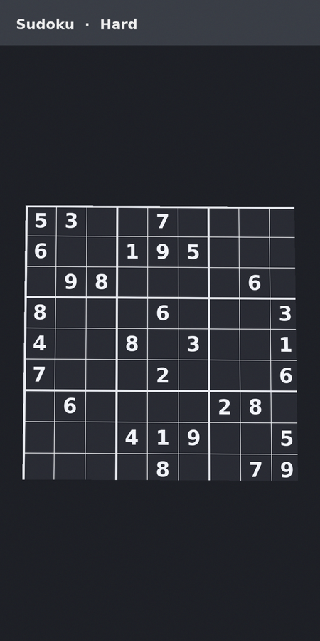

# Sudoku Assist — оверлей-помощник для судоку (Android)

Приложение поверх любого другого приложения: снимает экран, находит доску 9×9,
распознаёт цифры, решает судоку **локально** (без интернета) и рисует ответы
непосредственно над распознанными клетками.



* Всё работает офлайн: OpenCV + ML Kit (модель распознавания текста входит в APK),
  собственный решатель. Ни аналитики, ни рекламы, ни сетевых запросов.
* Скриншоты не сохраняются на диск: кадр живёт в памяти только на время распознавания.

---

## Что умеет

| Возможность | Как это сделано |
|---|---|
| Плавающая кнопка поверх любых приложений | `OverlayService` (foreground, `TYPE_APPLICATION_OVERLAY`), кнопку можно перетаскивать, позиция запоминается |
| Захват экрана | `MediaProjection` + `VirtualDisplay` + `ImageReader` (`ScreenCaptureService`, foreground-сервис типа `mediaProjection`) |
| Поиск доски 9×9 | `SudokuGridDetector`: маска «чернил» (адаптивный порог в двух полярностях + Otsu) → быстрый путь по проектным профилям осей → медленный путь по контурам с перспективной коррекцией → подгонка решётки из 10 линий (RANSAC-подобный поиск + МНК) |
| Распознавание цифр | ML Kit Text Recognition на выпрямленной доске + офлайн-классификатор по шаблонам (`DigitTemplates`, NCC по 16×16 карте «чернил») как fallback и арбитр |
| Решение | `SudokuSolver`: проверка противоречий + backtracking с эвристикой MRV |
| Отрисовка ответов | `DigitOverlayView`: прозрачный полноэкранный слой, цифры позиционируются гомографией клетки, чёрная обводка + яркая заливка (читается и на светлой, и на тёмной доске) |
| Ручная правка | `ManualEditView`: увеличенный фрагмент скриншота с сеткой, тап по клетке + цифровая клавиатура |
| Обновление | кнопка «Считать экран» + автоматическое обновление при изменении картинки на экране (грубая подпись 12×24 по яркости) |

## Требования

* Android 8.0 (API 26) и выше, arm64 (OpenCV AAR содержит нужные ABI).
* Android Studio Ladybug (2024.2) или новее, JDK 17.
* Разрешения: «Поверх других приложений», уведомления (Android 13+),
  согласие на захват экрана (выдаётся системным диалогом при каждом запуске).

## Сборка

```bash
./gradlew assembleDebug          # app/build/outputs/apk/debug/app-debug.apk
./gradlew installDebug           # если подключено устройство
./gradlew test                   # юнит-тесты решателя и геометрии (JVM)
```

Открыть в Android Studio: **File → Open** → каталог проекта. Всё уже настроено
(`compileSdk 35`, `minSdk 26`, Kotlin 2.0.21, AGP 8.7.2, Gradle 8.10.2).

Первый запуск Gradle скачивает зависимости, дальнейшая сборка — офлайн.

## Как пользоваться

1. Запустить приложение → выдать «Поверх других приложений» (кнопка ведёт в системные
   настройки) → «Разрешить уведомления» (Android 13+).
2. Нажать **Разрешить захват экрана** и подтвердить системный диалог.
3. Нажать **Запустить помощника** — появится плавающая кнопка «9».
4. Открыть судоку в любом приложении, нажать кнопку → **Считать экран**.
   Ответы появятся над пустыми клетками; рамка показывает, что именно распознано.
5. Если цифра распознана неверно — **Правка**: выбрать клетку, ввести цифру (пустая
   клетка = «Стереть»), нажать **Готово** — решение пересчитается сразу.
6. **Автообновление** (в настройках) пересчитывает доску, когда картинка на экране
   меняется, — удобно при переходе между уровнями.

### Проверка без второго приложения

Раздел «Проверка на образце» → откроется встроенный скриншот
(`assets/samples/sample1.png`), на нём прогоняется весь конвейер и ответы рисуются тем же
слоем, что и в оверлее. Рядом лежит эталон `sample1.grid.txt`, с которым можно сверить
результат.

## Архитектура

```
MainActivity            разрешения, согласие MediaProjection, запуск/остановка, настройки
TestActivity            офлайн-проверка конвейера на встроенном скриншоте
└─ capture/
   ScreenCaptureService foreground-сервис: MediaProjection, автообновление, OCR-поток
   ScreenCaptureManager VirtualDisplay + ImageReader → Bitmap (один кадр за раз)
   CaptureLauncher      состояние сессии MediaProjection, intent согласия
   CaptureConnection    Binder к сервису захвата (передача изменений настроек)
└─ overlay/
   OverlayService       foreground-сервис: кнопка, панель, слой ответов, редактор
   OverlayRenderer      окна WindowManager (слой ответов + панель)
   DigitOverlayView     отрисовка цифр и сообщений
   ManualEditView       редактор клеток
└─ vision/
   SudokuGridDetector   поиск доски, подгонка решётки, варпинг клеток
   GridGeometry         гомография «доска → экран», центры клеток
   SudokuRecognizer     маска занятости клеток + ML Kit + шаблоны
   DigitTemplates       офлайн-классификатор цифр
└─ solver/ SudokuSolver проверка + backtracking (MRV), подсчёт решений
└─ util/   Prefs, AppEvents (внутрипроцессная шина), Notifications
```

Данные между сервисами идут через `AppEvents` (оба сервиса в одном процессе):
`Working` → `GridFound` (сетка + решение) либо `Failure` (нет доски / ничего не
распознано / противоречие / нет решения).

## Алгоритм распознавания (кратко)

1. **Маска «чернил».** Размытие 3×3, адаптивный порог `MEAN_C` в двух полярностях
   (берётся более разреженная) + Otsu; инверсия, если «чернил» больше половины кадра.
   Так обрабатываются и светлые, и тёмные темы без настроек.
2. **Быстрый путь.** Проекции маски по осям (морфологическое открытие 1×k и k×1) →
   подгонка 10 равноотстоящих линий по каждой оси. Если обе оси согласованы по шагу —
   доска найдена за единицы миллисекунд (типичный случай для скриншотов).
3. **Медленный путь.** Контуры (`approxPolyDP`, `minAreaRect`) → до 10 кандидатов,
   отсортированных по размеру → для каждого варп на квадрат и подгонка решётки;
   уточнение повторяется 2–3 раза, затем ужесточается допуск на края.
4. **Проверка качества.** Оценка = согласованность линий × (1 − отклонение краёв).
   Слишком низкая оценка → «доска не найдена», ложные срабатывания на клавиатурах и
   таблицах отсекаются.
5. **Занятость клетки.** Отдельный Otsu внутри клетки, «чернила» — минорный класс,
   игнорируются пятна и компоненты, касающиеся границы (это линии сетки); требуется
   правдоподобный размер глифа.
6. **Цифры.** ML Kit читает выпрямленную доску (×2), боксы элементов сопоставляются
   клеткам; результат сверяется с шаблонным классификатором. Спорные клетки помечаются
   как «неуверенные», и при явном сбое сразу открывается ручная правка.

## Ограничения и что делать

* **Согласие на захват экрана** выдаётся заново после перезапуска (ограничение Android
  14+): приложение подскажет это сделать, кнопка в панели ведёт в настройки.
* **Реклама поверх доски** (баннеры, всплывающие окна) может перекрыть линии сетки —
  сверните баннер или увеличьте доску.
* **Сильный наклон/перспектива** и рукописные цифры распознаются хуже: используйте
  ручную правку.
* Некоторые прошивки «убивают» сервисы при выключенном экране — включите исключение из
  оптимизации батареи (кнопка в приложении).

## Тесты

`./gradlew test` запускает JVM-тесты без Android:

* `SudokuSolverTest` — корректность решения, противоречия по строке/столбцу/квадрату,
  «валидная, но нерешаемая» сетка, подсчёт решений, скорость.
* `GeometryTest` — гомография «доска → экран»: углы, центры клеток, проективное (не
  аффинное) поведение на трапеции, проверка вырожденных случаев.

## Перегенерация тестового скриншота

```bash
pip install pillow numpy
python3 tools/make_sample.py
```

Скрипт перерисовывает `app/src/main/assets/samples/sample1.png` (доска с перспективой,
переносами, шумом), эталон `sample1.grid.txt` и картинку для README.

## Лицензия и приватность

Код приложения — ваш, без внешних сервисов. OpenCV распространяется по лицензии
Apache 2.0, ML Kit Text Recognition — по условиям Google (модель работает на устройстве,
изображения никуда не отправляются).
